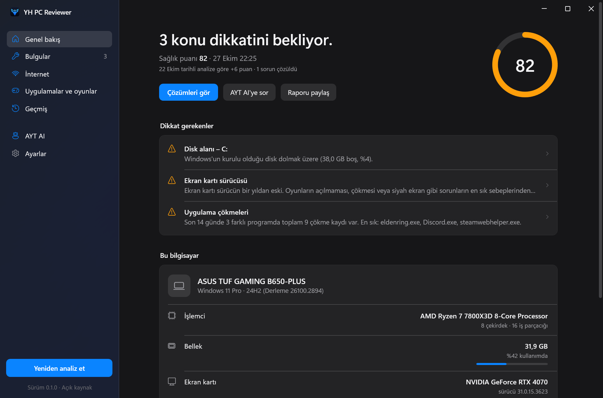
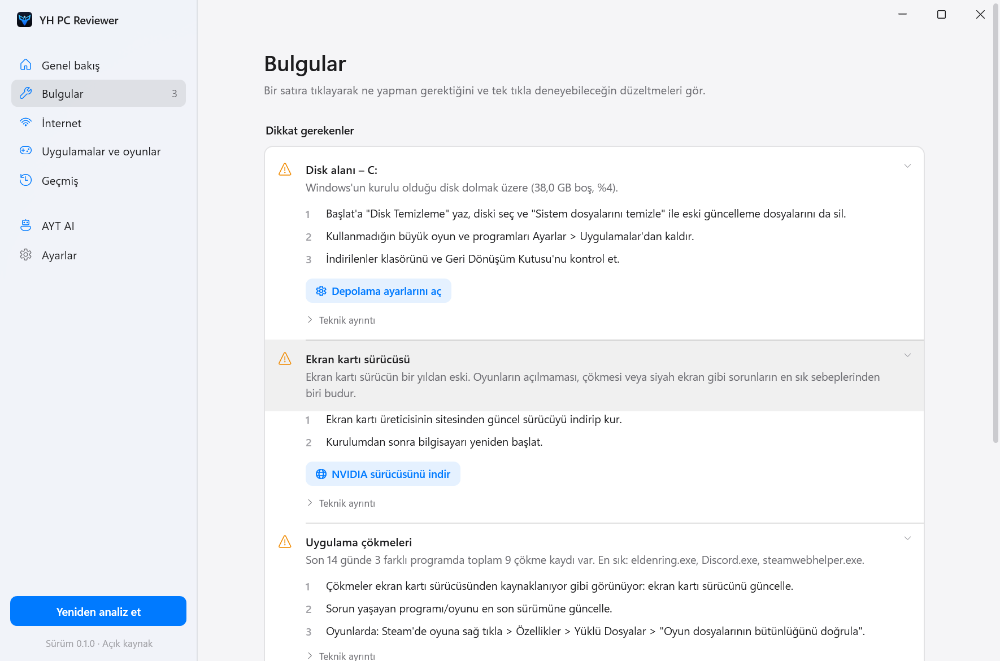
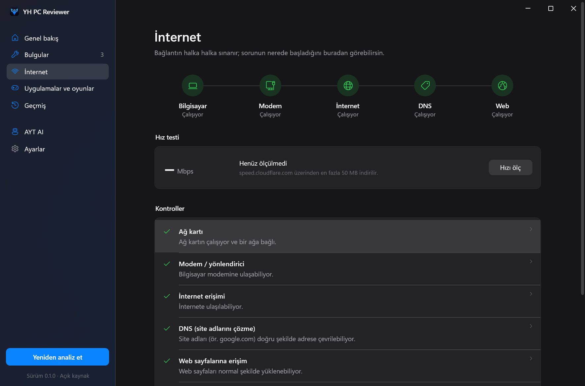

<p align="center">
  
</p>

<h1 align="center">YH PC Reviewer</h1>

<p align="center">
  Bilgisayarındaki sorunu bul, sade bir dille anla, adım adım çöz.<br>
  <b>Windows 10/11 · Kurulum gerektirmez · Yönetici izni istemez</b>
</p>

<p align="center">
  <a href="https://github.com/aytcode/YH-PCReviewer/releases/latest/download/YHPCReviewer-win-x64.exe"><b>⬇ İndir (Windows, 64 bit)</b></a>
  &nbsp;·&nbsp;
  <a href="https://aytcode.github.io/YH-PCReviewer/">Önizleme sayfası</a>
  &nbsp;·&nbsp;
  <a href="#güvenlik-ve-doğrulama">Güvenlik ve doğrulama</a>
  &nbsp;·&nbsp;
  <a href="PRIVACY.md">Gizlilik</a>
</p>

<p align="center">
  <a href="https://github.com/aytcode/YH-PCReviewer/actions/workflows/build.yml"></a>
  <a href="https://github.com/aytcode/YH-PCReviewer/releases/latest"></a>
  
</p>

<p align="center">
  
</p>

> Ekran görüntüleri uygulamanın örnek verili tanıtım modundan (`--demo`) alınmıştır.

## Ne yapar?

İnternet bağlanmıyor, oyunlar açılmıyor ya da çöküyor, bilgisayar yavaşladı veya kendi kendine kapanıyor mu?
Programı aç, **“Sorunları analiz et”**e bas. Yaklaşık 15 saniye sonra şunları görürsün:

- **Ne oldu:** Teknik bilgisi olmayan birinin de anlayacağı tek cümlelik açıklama.
- **Ne yapmalıyım:** Sırayla denenecek, güvenli çözüm adımları.
- **Tek tıkla dene:** İlgili Windows ayarını açma, DNS önbelleğini temizleme, eski geçici dosyaları silme gibi düzeltmeler. Bir şeyi değiştirenler önce onay ister.
- **Paylaş:** Kişisel bilgiler gizlenmiş raporu kopyalayıp YazılımHub'da yardım isteyebilirsin.

| | |
|---|---|
|  |  |

### Kontroller

| Alan | Neye bakar |
|---|---|
| İnternet | Ağ kartı, modem, internet erişimi, DNS, web erişimi ve giriş sayfası tespiti, gecikme, proxy; isteğe bağlı hız testi |
| Disk | Boş alan, disk sağlığı (SMART), geçici dosyalar, okuma/yazma hataları |
| Sistem | Bellek, yeniden başlatma, bekleyen güncelleme, açılış programları, ekran kartı sürücüsü yaşı, güç modu, pil yıpranması, beklenmedik kapanmalar, mavi ekranlar |
| Uygulamalar ve oyunlar | Son 14 günde çöken/donan programlar ve nedeni, eksik Visual C++ bileşenleri |
| Güvenlik | Antivirüs durumu, Windows Update'in son çalışması |

İsteğe bağlı **AYT AI** entegrasyonuyla raporunu yapay zekâya yorumlatıp soru sorabilirsin (OpenAI uyumlu API).

## Güvenlik ve doğrulama

Bir yazılımın güvenilir olduğunu söylemek yetmez; kontrol edebilmen gerekir. Bu yüzden:

**1. Kaynak kod burada, herkes okuyabilir.** Uygulamanın ne yaptığını satır satır görebilirsin. Önemli dosyalar:
[ağ testleri](src/YHPCReviewer/Diagnostics/NetworkChecks.cs) ·
[sistem kontrolleri](src/YHPCReviewer/Diagnostics/SystemChecks.cs) ·
[olay günlükleri](src/YHPCReviewer/Diagnostics/EventLogChecks.cs) ·
[kişisel bilgi gizleme](src/YHPCReviewer/Reporting/Redactor.cs) ·
[hızlı düzeltmeler](src/YHPCReviewer/Services/FixRunner.cs) ·
[AYT AI istemcisi](src/YHPCReviewer/AI/AiClient.cs)

**2. İndirdiğin exe bu koddan, GitHub'ın sunucularında derlenir.** Kimse kendi bilgisayarında derleyip dosya yüklemez.
[Sürüm iş akışı](.github/workflows/release.yml) exe'yi derler, SHA-256 özetini çıkarır ve GitHub'ın imzaladığı bir
**derleme kökeni kaydı (build provenance)** yayınlar. İndirdiğin dosyanın tam olarak bu depodan geldiğini doğrulamak için:

```bash
gh attestation verify YHPCReviewer-win-x64.exe --repo aytcode/YH-PCReviewer
```

ya da yalnızca özeti karşılaştırmak için (PowerShell), çıktıyı sürümdeki `SHA256SUMS.txt` ile karşılaştır:

```powershell
Get-FileHash .\YHPCReviewer-win-x64.exe -Algorithm SHA256
```

**3. Kendin derleyebilirsin.** [.NET 10 SDK](https://dotnet.microsoft.com/download/dotnet/10.0) ile:

```bash
dotnet run --project src/YHPCReviewer
```

**4. Neye dokunduğu açıkça yazılı.** Analiz yalnızca okur ve yönetici izni istemez.
Ayrıntılar: [PRIVACY.md](PRIVACY.md) (hangi verinin okunduğu, nereye bağlanıldığı) ve [SECURITY.md](SECURITY.md) (açık bildirme).

> **Windows SmartScreen uyarısı:** Exe henüz kod imzalama sertifikasıyla imzalanmadığı için ilk açılışta
> “Windows bilgisayarınızı korudu” uyarısı çıkabilir. *Ek bilgi → Yine de çalıştır* ile açabilirsin.
> Emin olmak için önce yukarıdaki doğrulamayı yap.

### Bağlandığı adresler

| Adres | Ne zaman | Neden |
|---|---|---|
| `1.1.1.1`, `8.8.8.8`, `9.9.9.9` (ping) | Analizde | İnternete erişimi ölçmek |
| `www.microsoft.com`, `www.google.com`, `www.cloudflare.com` (DNS) | Analizde | Site adlarının çözülüp çözülmediğini görmek |
| `www.msftconnecttest.com` | Analizde | Windows'un kendi “internet var mı” testi |
| `speed.cloudflare.com` | Yalnızca “Hızı ölç”e basınca | İndirme hızı |
| Senin girdiğin AYT AI adresi | Yalnızca soru sorduğunda | Gizlenmiş raporu ve soruyu göndermek |

Bunların dışında hiçbir sunucuya veri gönderilmez; telemetri, reklam ya da otomatik güncelleme yoktur.

## Komut satırı

```bash
YHPCReviewer.exe --report rapor.md   # arayüz açmadan, kişisel bilgileri gizlenmiş rapor yazar
YHPCReviewer.exe --demo              # örnek verilerle tanıtım modu
```

## Lisans

Kaynak kod görülebilir, ancak **açık kaynak değildir**: [PolyForm Strict 1.0.0](LICENSE).
Kodu okuyabilir, kişisel/ticari olmayan amaçlarla kullanabilir ve kendin derleyebilirsin;
değiştirilmiş sürümlerini ya da kopyalarını dağıtamaz, ondan başka bir ürün yapamazsın.
Ticari kullanım ya da başka bir izin için depo sahibiyle iletişime geç.

© 2026 aytcode
